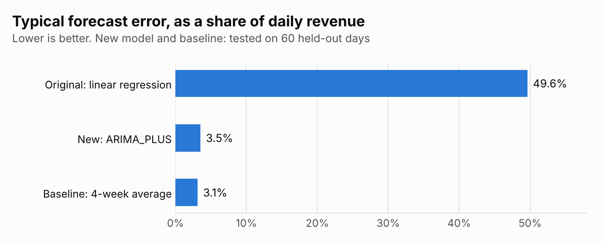
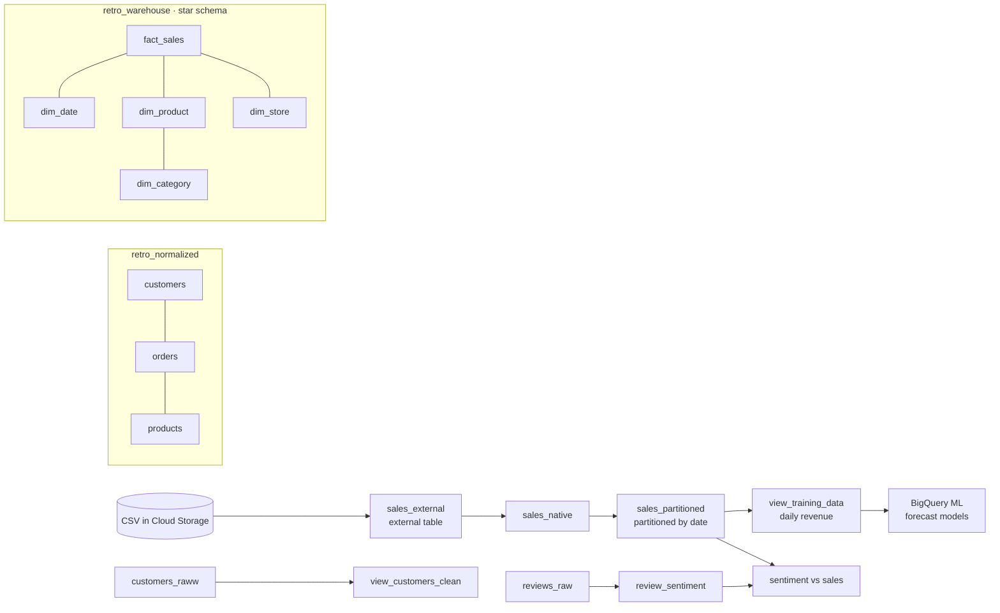
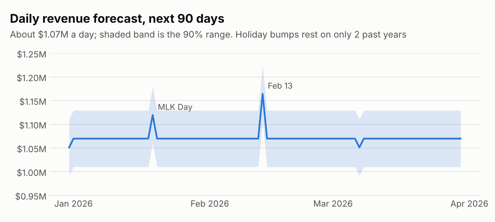
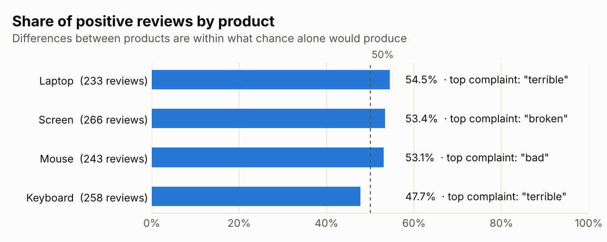

# Retail Revenue Forecasting on BigQuery

An end-to-end analytics project in Google BigQuery for **Retro**, a made-up retailer. The data goes from a raw CSV in Cloud Storage to a star-schema warehouse. On top of that sit a 90-day revenue forecast built with BigQuery ML and a review-sentiment analysis linked to sales.

The most useful result was a correction. **The first forecasting model was badly wrong**, and finding out why changed the recommendation.

**Timeline:** original BigQuery warehouse and forecast built in Spring 2026. Recovered SQL, backtested `ARIMA_PLUS` rebuild, and this README published here in November 2026.

## Results at a glance

| | |
|---|---|
| **Data** | 1,000,000 transactions over 2 years (Jan 2024 – Dec 2025), $780.8M revenue, 15 products in 3 categories, 8 countries, 1,000 product reviews |
| **First model** (linear regression) | R² = −229; typical error ≈ $527K a day (~50% of daily revenue) |
| **Rebuilt model** (ARIMA_PLUS) | 3.5% error on 60 held-out days |
| **Simple baseline** (last 4 weeks' average) | 3.1% error on the same 60 days |
| **Forecast** | ≈ $1.07M a day for the next 90 days (90% range ±$59K), ≈ $96.4M in total |
| **Reviews** | 52% positive, 48% negative; no product differs from the others beyond chance (χ² p = 0.42) |

<picture>
  <source media="(prefers-color-scheme: dark)" srcset="docs/forecast_error_dark.png">
  
</picture>

## The pipeline

| Step | File | What it does |
|---|---|---|
| 1 | [`sql/01_raw_layer.sql`](sql/01_raw_layer.sql) | Reads the CSV in place as an external table, then copies it into a native table and a **date-partitioned** table, so date filters only scan the days they need |
| 2 | [`sql/02_clean_customers.sql`](sql/02_clean_customers.sql) | A view that fixes capitalization, standardizes states, fills missing emails and removes duplicate customers |
| 3 | [`sql/03_normalized_model.sql`](sql/03_normalized_model.sql) | A normalized model: customers, products and orders, each stored once |
| 4 | [`sql/04_star_schema.sql`](sql/04_star_schema.sql) | A **star schema** for reporting: `fact_sales` with date, product, category and store dimensions |
| 5 | [`sql/05_training_data.sql`](sql/05_training_data.sql) | Daily revenue: the series the forecasting models learn from |
| 6 | [`sql/06_backtest_arima.sql`](sql/06_backtest_arima.sql) | Trains on all but the last 60 days and tests against them, next to a simple baseline |
| 7 | [`sql/07_forecast_arima.sql`](sql/07_forecast_arima.sql) | Final model on all the data, what it learned, and the 90-day forecast |
| 8 | [`sql/08_review_sentiment.sql`](sql/08_review_sentiment.sql) | Classifies every review as positive or negative |
| 9 | [`sql/09_sentiment_vs_sales.sql`](sql/09_sentiment_vs_sales.sql) | Sentiment, top complaint and sales side by side for each product |

## Forecasting: what went wrong, and what fixed it

**The first model** was a BigQuery ML linear regression on daily revenue. Its evaluation was alarming:
- **R² was −229.** An R² of 0 means "no better than always guessing the average", so −229 is far worse than that.
- **Its typical error was about $527K**, on days that average $1.06M.

A straight line through two years of daily revenue can't capture how revenue actually moves. Extended forward, it drifts away from reality.

**The rebuild** used **ARIMA_PLUS**, BigQuery ML's time-series model, with daily frequency, US holidays and automatic model selection. To test it fairly:
1. **Hold out the last 60 days.** The model is trained on everything before them.
2. **Forecast those 60 days and compare with what actually happened.**
3. **Compare against a simple baseline** that predicts "the same as the average of the previous 4 weeks". A model that can't beat this isn't worth its complexity.

| Model | Typical daily error | Share of daily revenue | Actual value inside the 90% range |
|---|---|---|---|
| Linear regression (original) | ≈ $527,000 | ≈ 50% | – |
| ARIMA_PLUS | $37,682 | 3.5% | 80% of days |
| 4-week average (baseline) | **$32,168** | **3.1%** | – |

The original model's error comes from BigQuery's own automatic evaluation, not the same 60 days, so that row is an approximate comparison.

**What the data turned out to be.** `ML.ARIMA_EVALUATE` shows the best model is **ARIMA(0,0,0)**, the simplest possible:
- no trend;
- no weekly or yearly seasonality;
- no spikes or level shifts;
- day-to-day noise of about ±$36K (3.4%) around a steady average.

In other words, revenue here is essentially **flat with random noise**, which is why a plain average does as well as anything. The only pattern ARIMA found is a small **holiday effect**.

<picture>
  <source media="(prefers-color-scheme: dark)" srcset="docs/forecast_dark.png">
  
</picture>

**Recommendation:**
- **Plan on about $1.07M a day, ±3%.** A rolling average is accurate enough and far easier to explain and maintain.
- **Treat the holiday bumps with caution.** The bumps on MLK Day (+$50K) and around Feb 13 (+$95K) each rest on only two past occurrences.
- **Revisit with ARIMA_PLUS if the business changes.** Promotions or seasonal products would give a time-series model something real to learn.

The 90-day forecast is in [`results/forecast_90_days.csv`](results/forecast_90_days.csv).

## Review sentiment

The 1,000 reviews are **synthetic**, generated from two templates:
- *"I [positive word] this [product]. It is [positive word]."*
- *"This [product] is [negative word]. It arrived [negative word]."*

They use just ten distinct words. So instead of a general-purpose sentiment model, a word list covering all ten classifies every review exactly. BigQuery's AI text models also need billing, and this approach runs in the free sandbox. The same pipeline (tokenize, look up, score, aggregate) works on real reviews with a fuller word list or an ML model.

<picture>
  <source media="(prefers-color-scheme: dark)" srcset="docs/sentiment_dark.png">
  
</picture>

| Product | Reviews | Positive | Top complaint | Revenue (2 years) |
|---|---|---|---|---|
| Keyboard | 258 | 47.7% | "terrible" | $51.8M |
| Mouse | 243 | 53.1% | "bad" | not in sales data |
| Screen | 266 | 53.4% | "broken" | $52.4M (sold as "Monitor") |
| Laptop | 233 | 54.5% | "terrible" | $51.5M |

**What it shows:**
- **No product stands out.** Keyboard is the only one below 50% positive, but a chi-square test finds the differences between products consistent with chance (p = 0.42). Sales are equally flat: every product sold between $51.5M and $52.6M.
- **The two datasets disagree on product names, and that's the most actionable finding.** Reviews say "Screen" where sales say "Monitor". "Mouse" has 243 reviews but no sales records at all. Before reviews can be linked to revenue reliably, the two systems need a shared product ID. Step 9 maps the name it can and reports the one it can't, instead of silently dropping it.

## Running it

1. **Create a BigQuery project.** The free sandbox is enough.
2. **Create three datasets:** `retro_raww`, `retro_normalized` and `retro_warehouse`.
3. **Run the files in `sql/` in order.** Point the external table in step 1 at your own copy of the sales CSV in Cloud Storage.
4. **Load the source data.** Each file creates its tables and views. Loading the data into the normalized and warehouse tables, and the raw customer and review records, happened in the original project and isn't repeated here.

**Note on recovered SQL:** the views, table definitions and models were recovered from the BigQuery project itself. The SQL that trained the original linear regression wasn't saved, so it's described here from the model's stored settings rather than reproduced.

## Tech

Google BigQuery · BigQuery ML (linear regression, ARIMA_PLUS) · Cloud Storage external tables · partitioned tables · star schema · SQL

## License

MIT © 2026 Navedita Chaudhary
